<div align="center">



<br/>

<a href="https://www.linkedin.com/in/manikanta-varaganti"></a>
<a href="mailto:mkvaraganti@gmail.com"></a>
<a href="https://manikanta-varaganti-resume.tiiny.site/"></a>
<a href="https://m2i101.github.io"></a>


</div>



## `$ neofetch`

```text
  ┌──────────────┐       manikanta@github
  │ ░▒▓ MV ▓▒░   │       ──────────────────────────────────────
  │  { dev }     │       OS ........ Human 4.0 (uptime: 4 years)
  │  </ >        │       Shell ..... zsh
  └──────────────┘       Langs ..... Python · Go · TypeScript · SQL · Java
                         Infra ..... GCP · AWS · Kubernetes · Docker · Terraform
                         Data ...... PostgreSQL · Redis · Kafka · MongoDB
                         Focus ..... distributed systems · agent platforms · LLMs
                         Edu ....... M.S. Computer Science, UCF (GPA 4.0)
                         Kernel .... curiosity-5.1.0 (unbounded)
                         Mem ....... 16 tabs / ∞ ideas
                         Status .... compiling
```


## `main.py`

```python
from about import Engineer


class Manikanta(Engineer):
    def philosophy(self):
        yield "make it work"
        yield "make it right"
        yield "make it fast"
        yield "then ask: can it improve itself?"   # <- the fun part

    def reach_me(self):
        return "mkvaraganti@gmail.com"


if __name__ == "__main__":
    for step in Manikanta().philosophy():
        print(f"> {step}")
```

```console
$ python main.py
> make it work
> make it right
> make it fast
> then ask: can it improve itself?
```


## `complexity.py`

<div align="center">
  
</div>


## `git log --graph`

```console
$ git log --graph --decorate

● f7a9c21 (HEAD -> main, tag: commure)
│   Commure
│   Software Engineer  ·  Jun 2025 → Oct 2026
│
● d95b2a6 (tag: ucf)
│   University of Central Florida
│   Applied AI Research Engineer  ·  Sep 2023 → May 2025
│
● 83e1f7b (tag: deloitte)
    Deloitte
    Software Developer  ·  Jul 2021 → Jul 2023
```


## `skills.toml`

```toml
# last updated: from my resume, not from vibes

[languages]
core   = ["Python", "Go", "TypeScript", "JavaScript", "SQL"]
also   = ["Java", "Bash/Shell", "HTML/CSS"]

[backend]
frameworks   = ["FastAPI", "Node.js"]
apis         = ["REST", "GraphQL", "gRPC", "WebSockets"]
architecture = ["Microservices", "Event-Driven", "Temporal", "Apache Kafka", "Pub/Sub", "Cloud Tasks", "Feature Flags"]

[data]
relational = ["PostgreSQL", "MySQL"]
nosql      = ["MongoDB", "Redis"]
streaming  = ["Apache Kafka", "Apache Flink (CDC)"]

[cloud]
platforms = ["GCP", "AWS (EC2, S3, Lambda, DynamoDB)"]
delivery  = ["Kubernetes", "Docker", "Terraform", "Helm", "Argo CD"]

[observability]
metrics = ["Prometheus", "Grafana", "Datadog"]
logs    = ["ELK", "Splunk"]
traces  = ["OpenTelemetry"]

[ai.agents]
models  = ["Generative AI", "LLMs", "RAG", "Vector Databases", "vLLM on H100s"]
systems = ["Multi-Agent Systems", "Agent Orchestration", "Tool Calling", "MCP", "A2A", "Agent Skills"]
craft   = ["Context Engineering", "Loop Engineering", "Agent Harnesses"]
tooling = ["LangChain", "LangGraph", "Claude Code", "Gemini", "OpenAI Codex", "Cursor"]

[tools]
dev     = ["Git", "GitHub", "GitLab", "Postman", "Figma"]
testing = ["PyTest", "Playwright", "Selenium", "Jest"]
```

<div align="center">

**Languages & backend**


**Data, cloud & delivery**


**Observability & tools**


**Distributed systems & delivery extras**


**Agent systems & AI tooling**


</div>


## `ls -lah ~/projects`

```text
drwxr-xr-x  detection-of-motorcyclists-without-helmet/   # machines that see        [Jupyter]
drwxr-xr-x  branch-predictor/                            # machines that anticipate  [Python]
drwxr-xr-x  cache-simulator/                             # machines that remember    [Python]
drwxr-xr-x  internship-portal/                           # people, matched to chances [HTML]
drwxr-xr-x  Garbagemonitoring/                           # IoT meets the bin         [C++]
```

<div align="center">

<a href="https://github.com/manikanta-varaganti/detection-of-motorcyclists-without-helmet"></a>
<a href="https://github.com/manikanta-varaganti/branch-predictor"></a>
<a href="https://github.com/manikanta-varaganti/cache-simulator"></a>
<a href="https://github.com/manikanta-varaganti/internship-portal"></a>

</div>


## `htop`

<div align="center">


</div>


## `TODO.md`

- [x] Ship systems that move 100,000+ files a month without dropping them
- [x] Serve LLMs on H100s and train across multi-node GPU clusters
- [x] Get 50+ engineers building agents without the boilerplate
- [x] Learn to read other people's code without sighing
- [ ] Build something that surprises its own author
- [ ] Understand what's actually going on inside the models
- [ ] Get to inbox zero (🙃)

<details>
<summary><code>sudo rm -rf /</code></summary>

<br/>

```console
$ sudo rm -rf /
rm: it is dangerous to operate recursively on '/'
rm: use --no-preserve-root to override this failsafe

nice try. 🙂  while you're here, my inbox is open: mkvaraganti@gmail.com
```

</details>


<div align="center">

```python
if __name__ == "__main__":
    coffee = True
    while coffee:
        build(); learn(); repeat()
```

<a href="https://www.linkedin.com/in/manikanta-varaganti"></a>
<a href="https://twitter.com/Manikanta_029"></a>
<a href="https://www.instagram.com/manikantavaraganti"></a>
<a href="https://open.spotify.com/user/313crjkpqlch5ajaqsaglaevr6fa"></a>

<br/><br/>

<a href="https://readme-jokes.vercel.app"></a>

<sub><code>process exited with code 0</code></sub>

</div>
